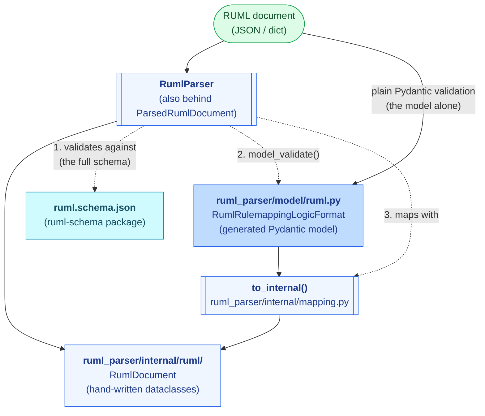
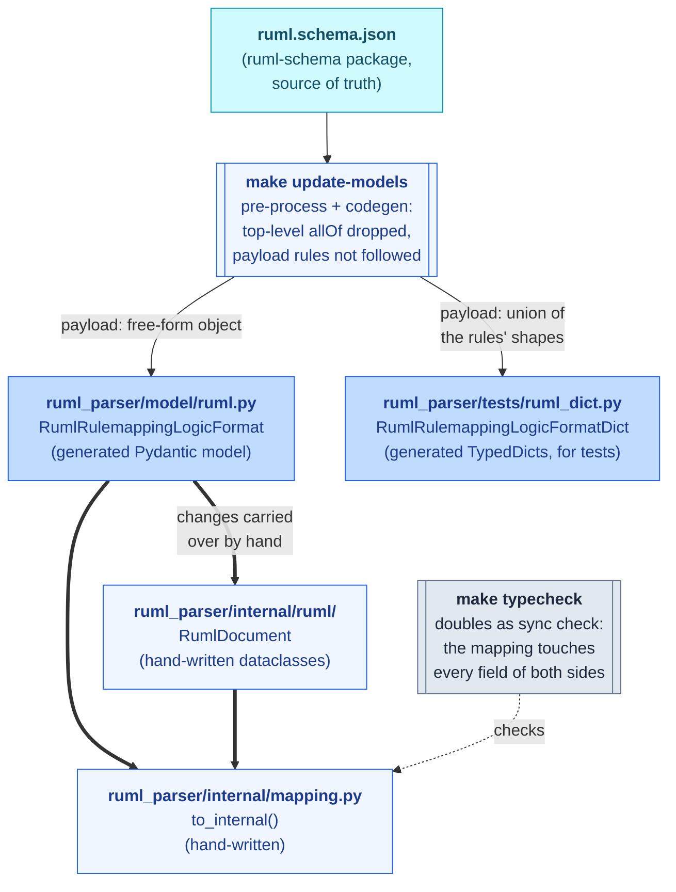

# Developing ruml-parser

This file contains information relevant to development of ruml-parser itself.

## Structure

```
ruml-parser/
├── scripts/
│   └── ruml_schema_pre_process.py     # Schema rewrite applied before code generation
└── ruml_parser/
    ├── ruml_parser.py                 # RumlParser: JSON text / dict / model → RumlDocument, with extensions
    ├── pydantic.py                    # ParsedRumlDocument: for rulemaps in Pydantic models, FastAPI params, ...
    ├── schema_files.py                # Paths & metadata of shipped schema files
    ├── schema_validation.py           # Full schema validation (incl. extensions' payload schemas)
    ├── text.py                        # RUML Text: readable text, element index, GUIDs, digest, writer
    ├── model/
    │   ├── ruml.py                    # Generated models: RumlRulemappingLogicFormat, Node, ...
    │   └── ruml_result.py             # Generated models: RumlResultRumlEvaluationResultFormat, ...
    ├── internal/
    │   ├── ruml/                      # Hand-written internal dataclasses, one folder per capability: RumlDocument, ...
    │   ├── mapping.py                 # to_internal(): generated model instance → internal dataclasses
    │   ├── extension.py               # CapabilityExtension: typed models of draft/third-party capabilities
    │   └── validation/                # Checks of the spec's cross-object rules on a RumlDocument
    └── tests/
        ├── ruml_dict.py               # Generated TypedDicts of RUML: RumlRulemappingLogicFormatDict, ...
        └── ruml_result_dict.py        # Generated TypedDicts of RUML-Result: RumlResultRumlEvaluationResultFormatDict, ...
```

`ruml_parser/model/ruml.py`, `ruml_result.py`, `tests/ruml_dict.py` and
`tests/ruml_result_dict.py` are **generated code**, so do not hand-edit them. See
[Regenerating the models](#regenerating-the-models).

## Model layers

Parsing of a RUML document is a two-step process: Pydantic models generated from the
RUML JSON Schema are utilized for the initial parsing; `to_internal` then converts these
into hand-written "internal" dataclasses (root model: `RumlDocument`), which are what
library users will work with. `RumlParser` can perform both steps at once:

<!-- Color code, uniform across the RUML READMEs (deliberately not explained to viewers — the colors only need to
match up subconsciously): blue = ruml-parser (one color per workspace package; hand-written files in the lighter
shade, generated ones in the slightly darker one), slate = repo-level tooling, green = runtime data. -->



<sup>**Legend:**   ─ transforms into   ⋯ uses</sup>

Two things about this pipeline are easy to trip over:

- **The generated model is a loosened approximation of the schema.** Code generation
  cannot express the schema's top-level `allOf` cross-field rules, which are dropped
  before generation (see [Regenerating the models](#regenerating-the-models)), nor the
  `if`/`then` rules that pick a capability payload's schema by the entry's id, which it
  ignores: every payload comes out as a free-form object. `RumlParser` therefore
  validates against the real schema *first* and only then parses into the model, as does
  `ParsedRumlDocument`, which uses it; validating with the model alone accepts slightly
  more than the schema allows. `RumlParser` collects every independent violation and
  reports the offending locations as JSON Pointers (`RumlValidationError.paths`).
- **The internal dataclasses are the working representation.** The generated models
  inherit every limitation of the schema, the code generator, and Pydantic — placeholder
  names like `Type1`, unions like `Actions1 | Actions2 | Actions3`, capability entries
  whose payload type is not selected by their id. The hand-written twin in
  `internal/ruml/` fixes those where it matters; `to_internal()` translates a validated
  model instance into it, rejecting what it cannot represent (a capability payload of
  the wrong shape for its id), and then runs the checks in `internal/validation/` on the
  result: the spec's cross-object rules that neither the schema nor the types can
  express, such as "no implicit capabilities" (a node may only use capabilities the root
  declares).

During development, the different layers and schemas from which they are generated are
kept in sync partly mechanically and partly by hand:

<!-- Color code, uniform across the RUML READMEs (deliberately not explained to viewers — the colors only need to
match up subconsciously): blue = ruml-parser (one color per workspace package; hand-written files in the lighter
shade, generated ones in the slightly darker one), slate = repo-level tooling, green = runtime data. -->



<sup>**Legend:**   ━ carried over by hand   ─ generates   ⋯ checks</sup>

Because the mappers touch every field of both sides, type-checking doubles as a sync
check after a regeneration — see the module docstring of `internal/ruml/__init__.py` for
the conventions.

## Regenerating the models

To update Pydantic models generated from JSON Schemas, run:

```bash
make update-models   # from the repo root
```

This runs the repo-level `scripts/update_models.py`, which drives
[`datamodel-code-generator`](https://github.com/koxudaxi/datamodel-code-generator)
against every schema-generated model in the workspace: the four models here
(`model/ruml.py`, `model/ruml_result.py` and the test-facing TypedDicts in
`tests/ruml_dict.py` and `tests/ruml_result_dict.py`), plus those of other workspace
members, such as the spec-test descriptor model in
[ruml-spec-tests](../ruml-spec-tests). The RUML and RUML-Result schemas come from the
`ruml-schema` package, pinned exactly in `pyproject.toml`; run it whenever that pin
changes.

The script pre-processes `ruml.schema.json` before generation (via
`scripts/ruml_schema_pre_process.py`) to fix schema problems that the generator cannot
handle.
